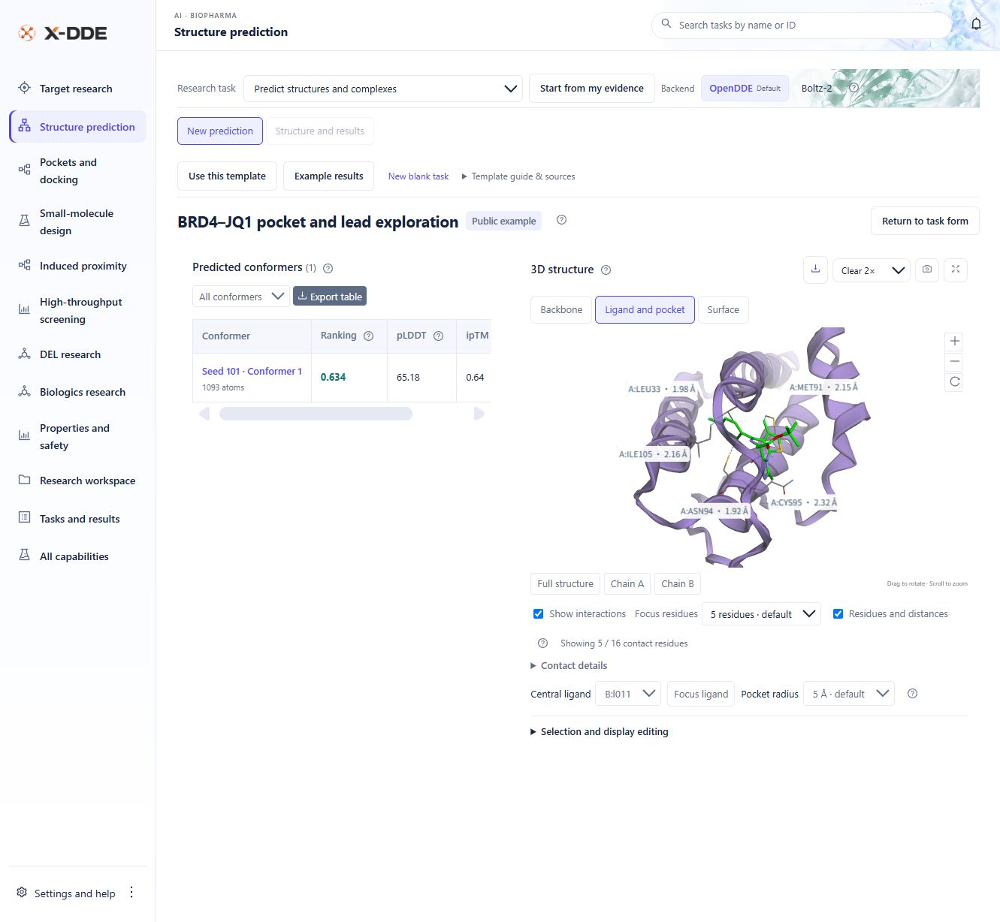
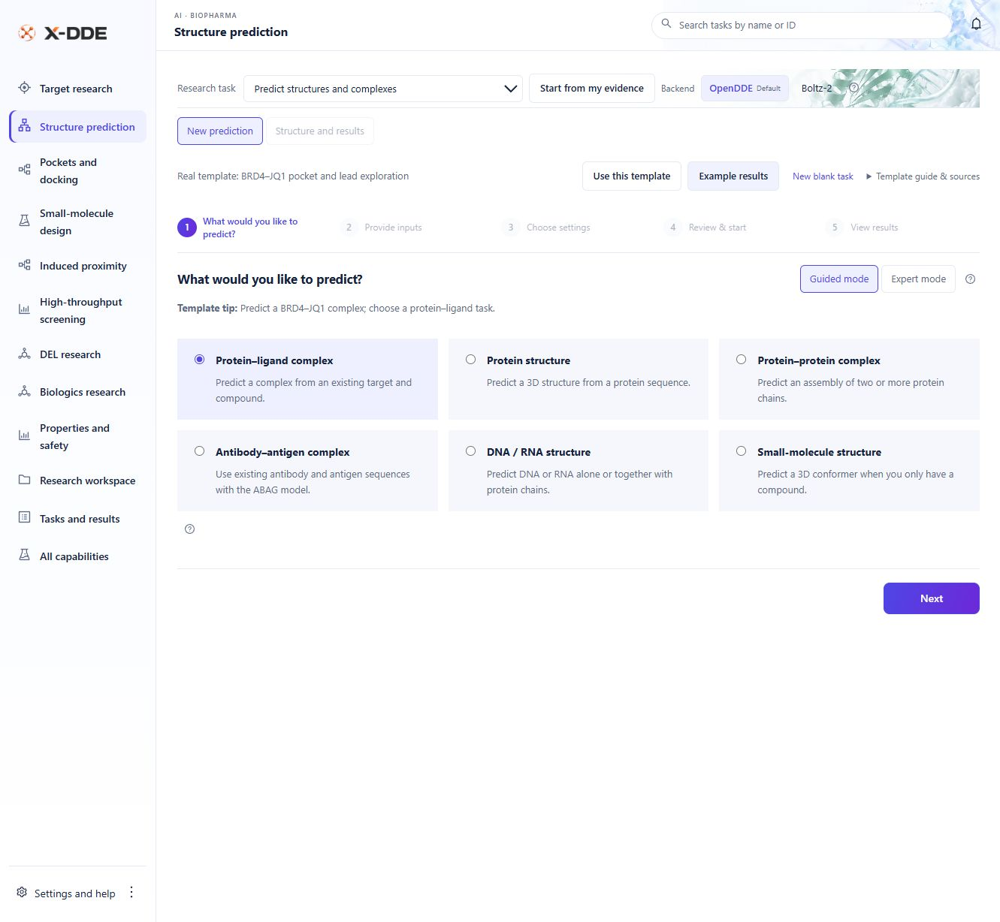
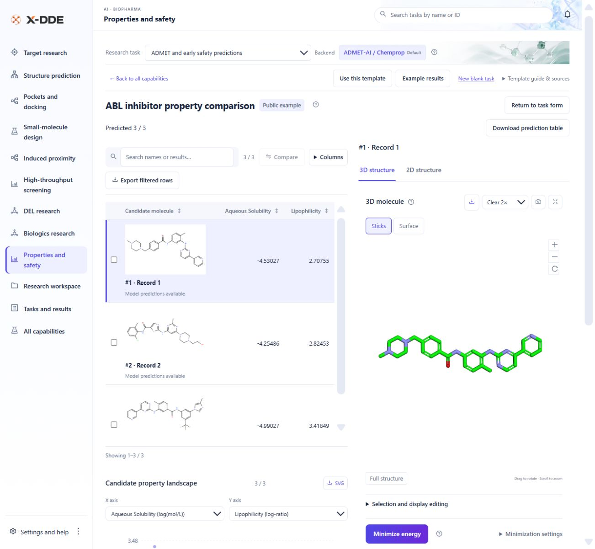
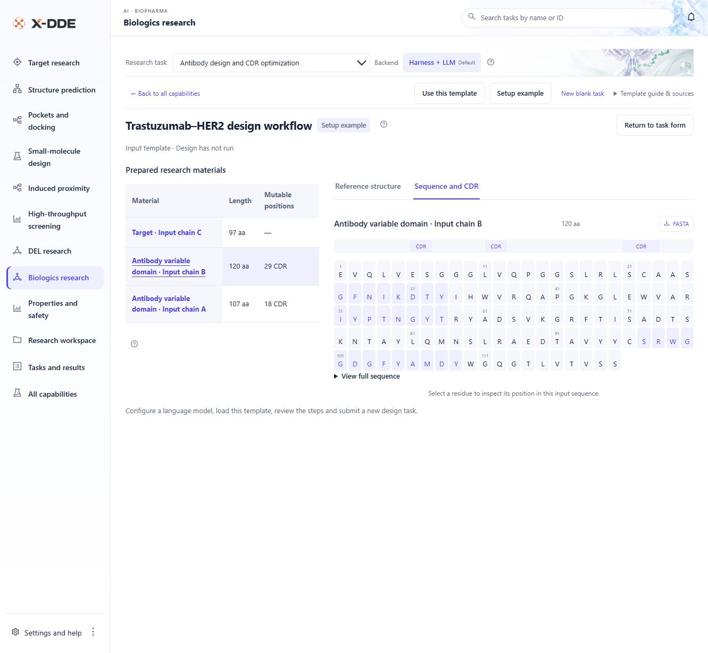
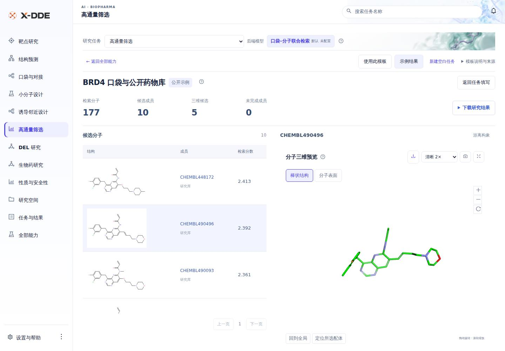
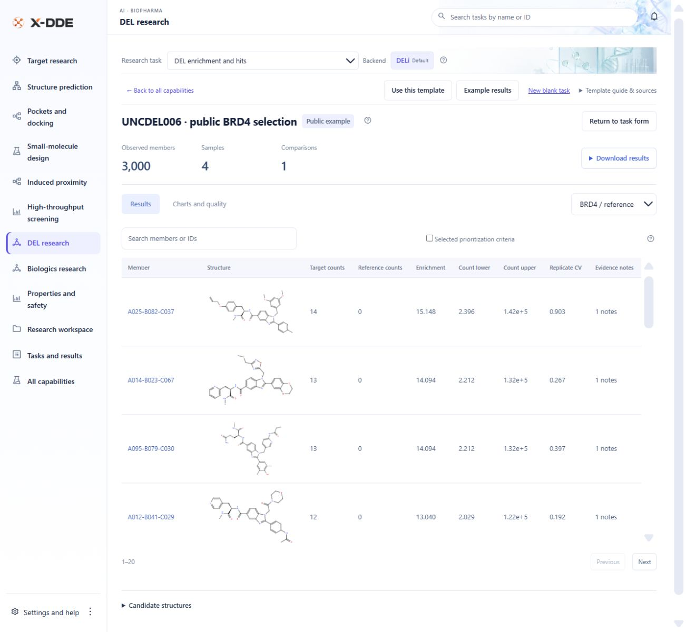
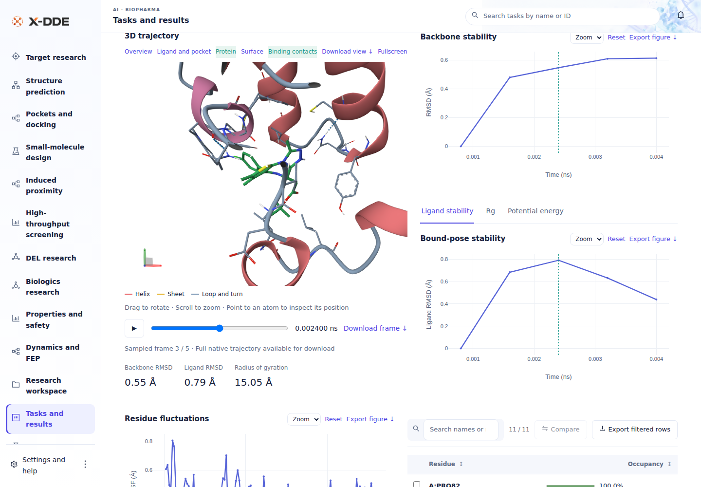

# X-DDE

**中文** · [English](README.en.md)

### 把分散的科学工具，连成可以继续的药物发现研究。

X-DDE 是面向早期药物发现的开源可视化研究平台。围绕靶点、结构和候选分子，在同一个工作台中
准备任务、选择方法、查看结果，再把已有材料交给下一步。

它适合小分子、抗体、蛋白与肽、分子库筛选和 DEL 研究，让研究人员少花时间搬运文件、切换工具，
把注意力放在更重要的问题上：**下一步研究什么，依据是什么？**

[开始使用](#开始使用) · [研究场景](#从研究问题到下一步) · [最新发行版](https://github.com/Victor-Xu-1/X-DDE/releases) · [Apache-2.0](LICENSE)



*公开 BRD4–JQ1 案例的原生模型结果。模型置信度不等于实测结合活性。*

## X-DDE 解决什么问题

药物发现已有许多优秀的科学工具，真正费力的往往是把它们一起用好。

- **让工具围绕研究目的组织。** 从“预测结构”“寻找结合模式”“比较候选”等问题进入，按需准备独立的科学环境
- **让一次结果成为下一次输入。** 从结构到口袋、从口袋到分子、从候选到性质和对接，选择明确的材料与版本继续研究
- **让结果看得懂、查得到。** 候选表格联动二维分子、三维结构、序列和分析图，原始材料与派生版本保留，可比较、下载和复核

X-DDE 将 OpenDDE、Boltz-2、DiffSBDD、GNINA 等科学软件连接到统一的研究界面，保留各自的方法、
运行环境和许可。具体任务仍由相应的科学工具执行。

## 从研究问题到下一步

### 先把任务准备清楚

选择研究目的，提供材料，选择方案，确认后运行。分步表单一次聚焦一个问题；推荐选项帮助入门，
专家模式保留方法和参数的控制。公开研究模板帮助理解输入要求，已有示例结果帮助学习如何读结果。



*图为输入模板。加载模板不会启动计算；提交后才会创建自己的新任务。*

### 从靶点与结构，找到值得研究的结合位点

收集靶点证据、规范序列和公开结构，准备或预测蛋白与复合物，再检查候选口袋、结合姿势和相互作用。
点击候选即可查看对应的结构，比较不同姿势，并将确认的受体与口袋用于后续分子生成或筛选。

结构预测、口袋寻找、对接、重评分和姿势质控可以组合使用。模型置信度、对接分数与几何接触各有含义，
不能直接替代实测亲和力。

### 从候选分子，走向有依据的比较

围绕口袋生成分子，探索类似物与局部修改，准备分子状态和游离构象，再比较性质、结构风险与结合姿势。
二维结构、候选指标和三维分子联动，让每一行数字都能回到具体的分子。



*预测终点保留原始名称和单位；性质与早期安全性预测用于研究筛选，仍需实验验证。*

### 从蛋白与抗体序列，继续设计和结构检查

查看抗体编号与 CDR，选择可变位置，开展抗体、蛋白或肽设计，再进行序列评分、折叠与界面分析。
序列和结构一起检查，帮助比较候选，也让每轮修改有可回看的材料。



*图为已校验的设计输入模板，未运行新的抗体设计。实验参考、输入材料与新生成结果分别保留。*

### 从分子库，筛出值得进一步计算的候选

导入合法取得的供应商或自有分子库，完成结构准备和索引，按口袋检索并结合多样性选择缩小候选范围，
再对重点分子做独立对接。库成员编号和供应商标识随候选保留，方便回到原始材料。



*图为 177 个公开研究分子的检索案例；三维预览是游离构象，并非结合姿势，也不是大库吞吐性能基准。*

### 从 DEL 读数，走向可解释的系列与候选

把库定义、成员结构和测序读数联系起来，开展解码、UMI 与计数、富集与对照分析、砌块系列比较。
将计数、重复信息和结构放在一起，选出值得继续做性质、对接或实验跟进的候选。



*公开实验数据的原生分析结果。计数和富集证据不等于结合亲和力，缺失信息保持未报告。*

### 从静态姿势，继续观察动力学与自由能

使用 OpenMM 或 GROMACS 研究蛋白与复合物动力学，将三维轨迹与 RMSD、RMSF、回转半径和接触占有率
联动查看。对满足输入条件的同系列、同净电荷分子，可用 OpenFE 规划变化网络并计算相对结合自由能，
结合原生误差、采样重叠与收敛诊断审阅结果。



*图为保留的 BRD4–JQ1 原生短模拟结果。短程运行可检查计算链路，不能证明充分采样或亲和力预测准确性。*

诱导邻近研究还可探索三元复合物、降解剂与其他双功能分子的装配假设。
这些结构假设仍需相应的计算检查和实验验证。

## 开始使用

从 [GitHub Releases](https://github.com/Victor-Xu-1/X-DDE/releases) 下载系统对应的安装器。
发行包已包含前端，无需安装 Node.js 或自行编译界面。

**Windows PowerShell**：下载 `install.ps1`，运行：

```powershell
powershell -NoProfile -ExecutionPolicy Bypass -File .\install.ps1
X-DDE UI
```

**Linux / WSL**：下载 `install.sh`，运行 `bash install.sh`，按安装器提示配置命令路径，再运行 `xdde dashboard`。

进入“设置与帮助 → 安装与运行”，按研究用途选择所需组件、模型与数据。
科学环境、资源和硬件决定任务能否执行，不需要为了开始使用而一次安装全部可选组件。
详细步骤见[使用指南](docs/user-guide.md)。

## 使用范围与研究责任

- **研究用途。** 计算结果需要结合来源、方法、输入与不确定性审阅；软件检查、示例截图和短程计算不构成科学准确性或临床适用性的证明
- **明确边界。** RNA / DNA 主要用于结构输入、复合物预测及特征准备；通用核酸药物设计、合成路线、逆合成和湿实验自动化不在当前范围
- **资源与数据。** 部分任务需要 GPU、较大存储、模型或外部服务。供应商目录不代表已取得完整商业库、实时库存或采购授权；使用前核对数据去向与访问权限
- **安全访问。** 当前是单用户、本机环回访问的工作台；服务器使用应通过受控访问或 SSH 隧道，不要直接公开无认证服务

界面图片来自运行中的软件，采用公开研究材料；版本和来源见[图片说明](docs/images/README.md)。
进一步了解[研究案例](docs/design/research-examples.md)、[筛选与 DEL](docs/design/screening-and-del.md)
及[动力学与自由能](docs/simulations.md)。

## 开源许可与致谢

X-DDE 原创代码采用 [Apache-2.0](LICENSE)，归属声明见 [NOTICE](NOTICE)。集成的软件、模型、权重、
数据与输出保留各自许可，可能包含 GPL、署名或非商业研究条件。例如，当前官方 DrugCLIP 权重、
预编码数据和模型输出适用 CC BY-NC 4.0；X-DDE 的许可不会扩大这些使用权。

感谢 OpenDDE、Boltz、DiffSBDD、GNINA、RDKit、OpenMM、GROMACS、OpenFE、DrugCLIP、DELi、
Mol*、Ketcher 等上游项目。历史 MIT 发行版保留其随附条款；仓库不包含私有研究数据、服务密钥或上游大型模型权重。
